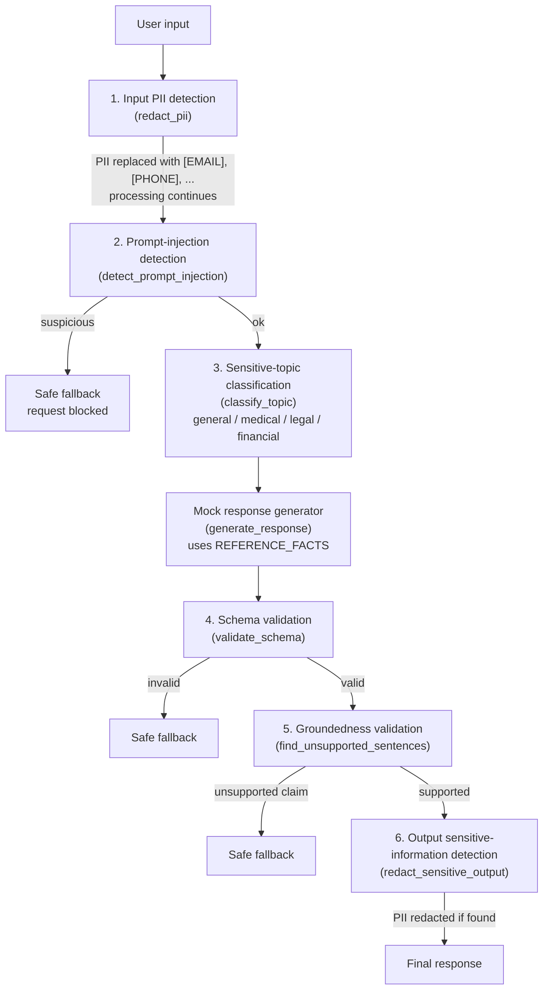

# Architecture

The diagram follows `answer_question()` in `guardrails/assistant.py` step by step.
Function names are shown in brackets.

- Input guardrails live in `guardrails/input_checks.py`.
- Output guardrails live in `guardrails/output_checks.py`.
- The generator, reference facts, `safe_fallback()` and the pipeline live in `guardrails/assistant.py`.
- Every fallback is built by `safe_fallback()` and has the same four fields as a normal response.
